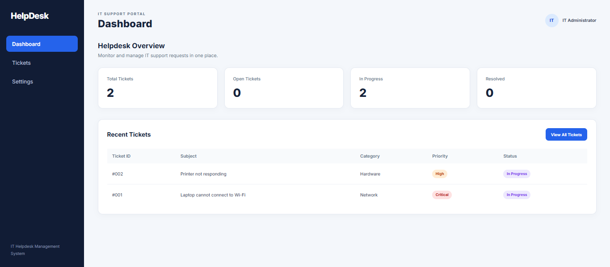
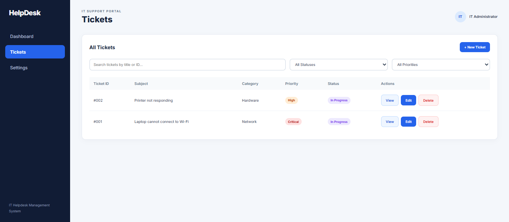
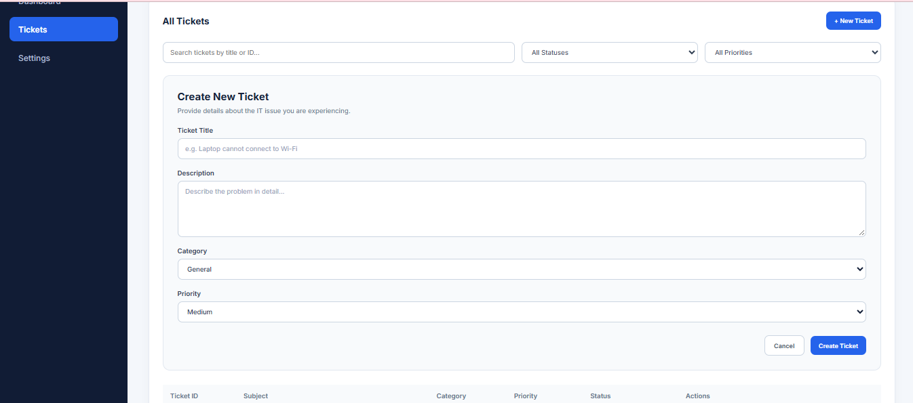
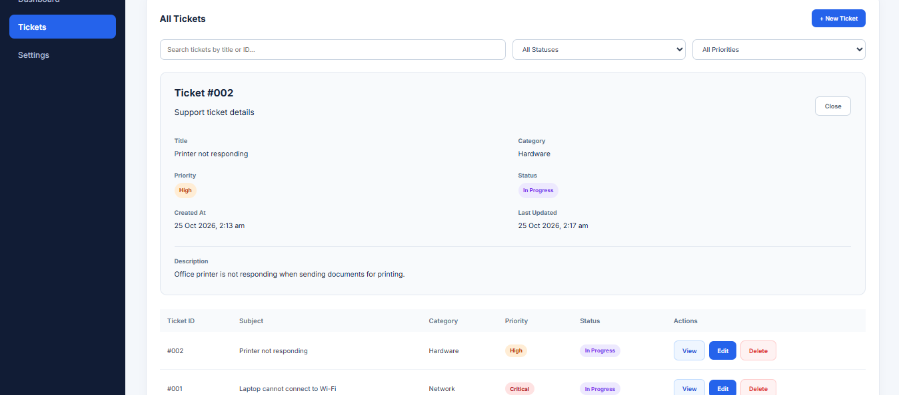

# IT Helpdesk Ticket Management System

A full-stack IT support ticket management application built with React, FastAPI, SQLAlchemy, and SQLite.

The project demonstrates REST API development, database integration, frontend development, CRUD operations, automated API testing, and practical IT support workflows.

## Application Screenshots

### Dashboard



### Ticket Management



### Create Ticket



### Ticket Details


## Features

- Dashboard with ticket statistics
- Create new IT support tickets
- View ticket details
- Update ticket status and priority
- Delete tickets with confirmation
- Search tickets by title or ID
- Filter tickets by status and priority
- Success and error notifications
- Responsive web interface
- RESTful API with automatic Swagger documentation
- Automated backend tests using Pytest

## Technology Stack

| Layer           | Technologies                 |
| --------------- | ---------------------------- |
| Frontend        | React, JavaScript, Vite, CSS |
| Backend         | Python, FastAPI, Pydantic    |
| Database        | SQLite, SQLAlchemy           |
| API Testing     | Pytest, FastAPI TestClient   |
| Version Control | Git, GitHub                  |

## Project Structure

```text
it-helpdesk-system/
├── backend/
│   ├── database.py
│   ├── init_db.py
│   ├── main.py
│   ├── models.py
│   ├── requirements.txt
│   └── tests/
│       ├── conftest.py
│       ├── test_health.py
│       └── test_tickets.py
├── frontend/
│   ├── public/
│   ├── src/
│   │   ├── App.jsx
│   │   ├── App.css
│   │   ├── TicketForm.jsx
│   │   ├── TicketEditForm.jsx
│   │   ├── TicketDetails.jsx
│   │   ├── Notification.jsx
│   │   └── index.css
│   ├── package.json
│   └── vite.config.js
├── .gitignore
└── README.md
```

## Getting Started

### Prerequisites

- Python 3.10 or later
- Node.js and npm
- Git

### Backend Setup

Open a terminal in the project root:

```powershell
cd backend

python -m venv .venv

.\.venv\Scripts\Activate.ps1

python -m pip install -r requirements.txt

python init_db.py

python -m uvicorn main:app --reload
```

Backend API:

http://127.0.0.1:8000

Swagger API documentation:

http://127.0.0.1:8000/docs

### Frontend Setup

Open another terminal in the project root:

```powershell
cd frontend

npm ci

npm run dev
```

Frontend application:

http://localhost:5173

## API Endpoints

| Method | Endpoint      | Description           |
| ------ | ------------- | --------------------- |
| GET    | /             | API root              |
| GET    | /health       | Health check          |
| GET    | /tickets      | Retrieve all tickets  |
| GET    | /tickets/{id} | Retrieve ticket by ID |
| POST   | /tickets      | Create a ticket       |
| PATCH  | /tickets/{id} | Update a ticket       |
| DELETE | /tickets/{id} | Delete a ticket       |

## Ticket Management

Each ticket includes:

- Ticket ID
- Title
- Description
- Category
- Priority
- Status
- Created timestamp
- Updated timestamp

Priority levels:

Low, Medium, High, Critical

Ticket statuses:

Open, In Progress, Resolved

## Automated Testing

The backend includes 10 automated tests covering:

- API health check
- Ticket creation
- Ticket listing
- Input validation
- Individual ticket retrieval
- Missing ticket handling
- Ticket updates
- Updating nonexistent tickets
- Ticket deletion
- Deleting nonexistent tickets

Run the tests from the backend directory:

```powershell
python -m pytest -v
```

Latest local test result:

**10 passed, 0 failed**

Tests use an isolated in-memory SQLite database to avoid modifying application data.

## Frontend Production Build

To verify the frontend builds successfully:

```powershell
cd frontend
npm run build
```

## Future Improvements

- User authentication and role-based access control
- Ticket assignment to IT support staff
- Ticket comments and activity history
- Email notifications
- Ticket reporting and analytics
- Deployment and CI/CD pipeline

## Project Purpose

This project was developed as a software engineering portfolio application to demonstrate practical experience in full-stack development, RESTful APIs, database operations, automated testing, and IT support system workflows.

## Author

Muhamad Fauzan Bin Khairil Azhar

GitHub: https://github.com/Onengss

LinkedIn: https://www.linkedin.com/in/muhamad-fauzan-96b5b4263/
